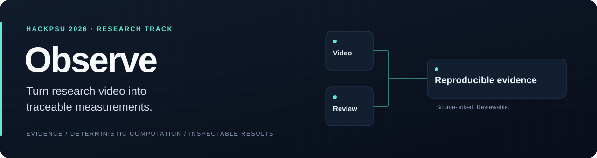
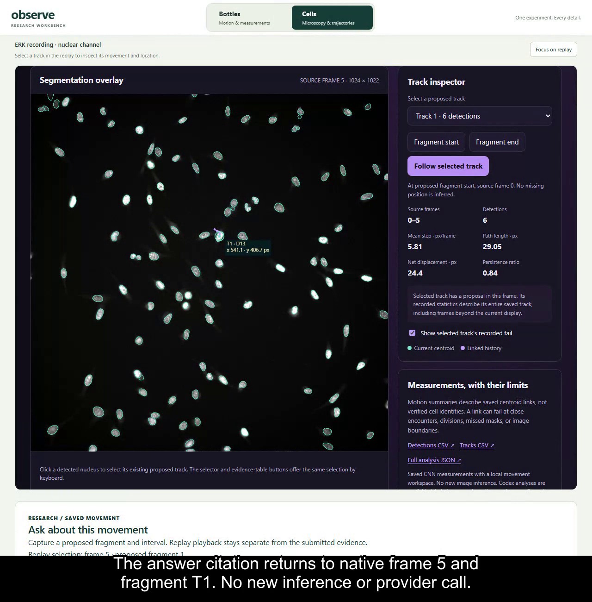
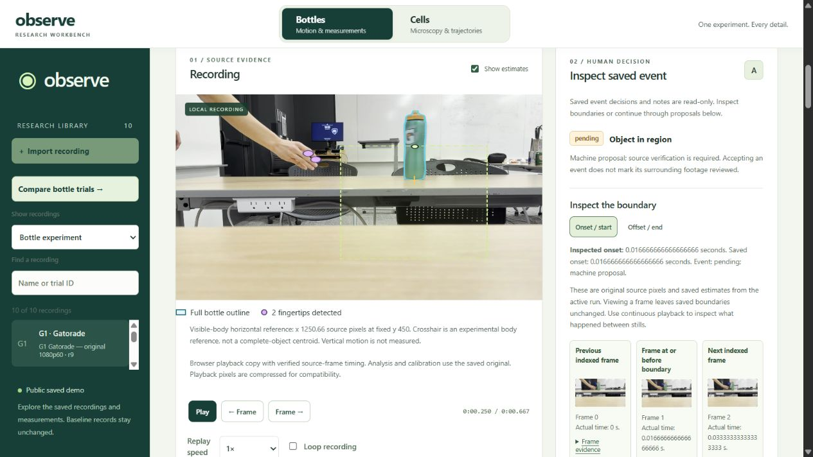
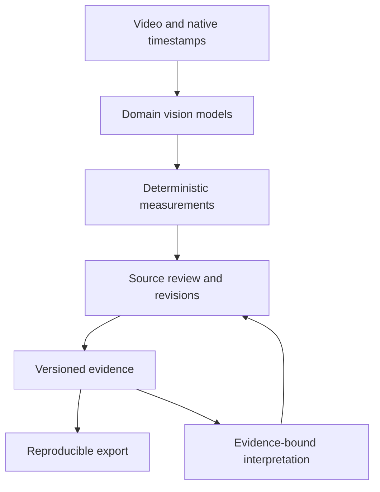

  <strong>Built for HackPSU 2026 Research Track</strong> 
  A research video analysis platform for object tracking and reproducible measurements.

<a href="#product">Product</a> · <a href="#engineering">Engineering</a> · <a href="#my-contribution">My contribution</a> · <a href="ATTRIBUTION.md">Attribution</a>

## Overview

Observe connects research recordings to measurements researchers can inspect. Vision models propose geometry, deterministic code calculates results, and the workbench links each observation to its source frame.

The project combines **cell movement** and **physical-object motion** in a React/TypeScript interface backed by Python and FastAPI.

## Product

### Cell movement

This saved example shows StarDist nuclear masks and provisional fragment associations. It is not a verified biological identity or a measurement of ERK signalling. Nuclear-channel data: Tinevez/Pylvänäinen, [Zenodo 5205955](https://doi.org/10.5281/zenodo.5205955), CC BY 4.0.

### Objects in motion

Ten sliding-bottle trials connect recorded footage to frame-level positions, motion fits, and source review. The recorded demo processed **476 native frames** and retained **447 usable body positions**. These counts describe availability, not independent tracking accuracy; physical friction remained unverified.

## Engineering

| Design choice | Purpose |
| --- | --- |
| Native video timestamps | Keep observations aligned with the actual recording. |
| Domain-specific vision models | Use YOLO, MediaPipe, and StarDist for their respective tasks. |
| Deterministic measurement code | Keep numerical calculations separate from language-model interpretation. |
| Immutable runs and revisioned review | Preserve model settings, source hashes, corrections, and undo history. |
| Evidence-grounded research questions | Connect interpretations and comparisons to structured facts and source citations. |
| Reproducible exports | Replay saved bottle measurements without inference or networking. |
| Accessible review controls | Pair visual views with semantic tables, keyboard operation, and numeric editing. |

**Stack:** React, TypeScript, Vite · Python, FastAPI · PyAV/FFmpeg · YOLO, MediaPipe, StarDist.

## My contribution

**Daniel Pan · research interpretation and integration.** I owned the research-chat lane, including evidence-grounded experiment comparisons and research-question workflows. My recorded work also includes comparison setup, cell research bindings, draft/export fixes, and demo validation.

Built collaboratively by **Oliver Chen, Daniel Pan, and Vincent Zhu**.

## Scope

Observe is a research prototype. Model proposals, human review, and unknown observations remain distinct. Demonstration coverage does not establish clinical validity, participant benefit, physical-measurement accuracy, or time savings.

**This repository is a portfolio showcase.** It contains this overview, the header graphic, two existing application screenshots, and their attribution. Source code, team working records, raw recordings, and deployment configuration remain private. The temporary hackathon-hosted demo was scheduled to expire on October 25, 2026.
